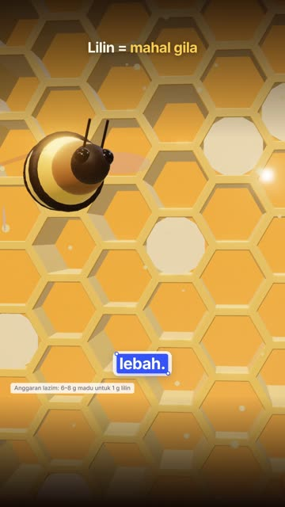
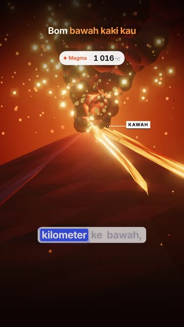
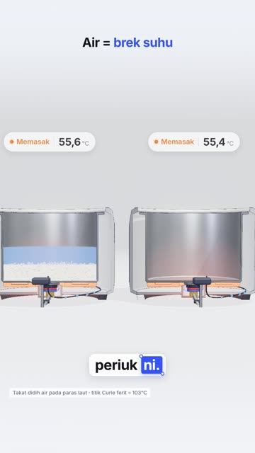
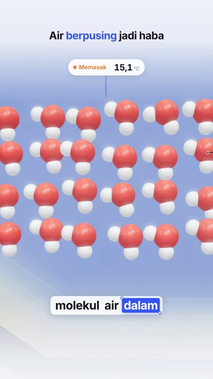
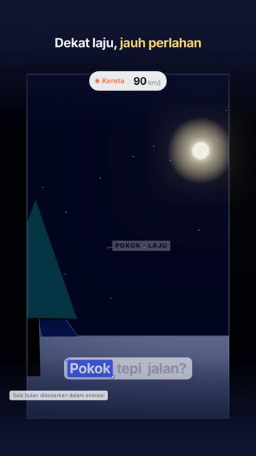
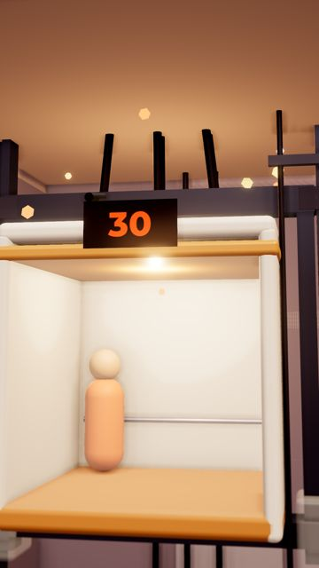
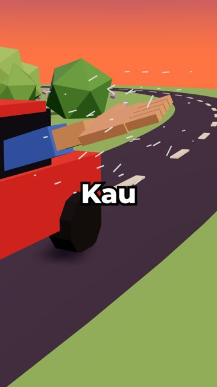

# Panduan Style Video

Rujukan ringkas untuk semua style video dalam repo ni. Tak perlu hafal nama versi: dalam chat baru, sebut je
nama video contoh (contohnya *"macam video lebah"*) dan Claude akan faham.

---

## ⭐ v4 Sinematik (paling gempak)

| Lebah | Gunung berapi |
|---|---|
|  |  |

**Rupa:** latar gelap, satu warna dominan (emas, merah-oren), objek berkilat dan bercahaya, bloom, vignette,
partikel terapung, kamera macro dekat.

**Sesuai untuk:** benda yang **cantik secara visual**: alam semula jadi, haiwan, angkasa, api, badan manusia, makanan.

**Contoh projek:** `lebah-video/`, `gunung-video/`

**Cara minta:**
> "Buat video [topik] guna style **v4 sinematik**."
> "Visual macam video **lebah**."

---

## v3 Teknikal (bersih dan jelas)

| Periuk nasi | Microwave | Versi malam (bulan) |
|---|---|---|
|  |  |  |

**Rupa:** latar putih kebiruan, garis hitam halus macam lukisan teknikal, keratan rentas (cutaway), HUD nombor
live, label penunjuk. Ada **versi malam** (latar biru gelap) untuk topik waktu malam.

**Sesuai untuk:** benda **mekanikal** atau cara sesuatu berfungsi: periuk, aircond, microwave, enjin, kunci, alat rumah.

**Contoh projek:** `ricecooker-video/`, `microwave-video/`, `aircond-video/`, `pressure-video/`,
`langit-video/`, `bulan-video/` (versi malam)

**Cara minta:**
> "Buat video [topik] guna style **v3 teknikal**."
> "Visual macam video **periuk nasi**."

---

## Style lama (masih boleh guna)

| v2: Lif | v1: Kapal terbang |
|---|---|
|  |  |

**Rupa:** pulau terapung low-poly waktu senja, warna kartun yang hangat. Kapsyen satu perkataan besar.

**Contoh projek:** `lift-video/` (v2), `plane-video/` (v1)

---

## Kalau tak pasti nak pilih yang mana

Cakap je topik dan *"buat visual gempak"*. Claude akan pilih sendiri:
- Topik **mekanikal** → v3 teknikal
- Topik **cantik secara visual** → v4 sinematik

---

## Tetapan yang dah jadi standard

- **Format:** 1080×1920 (9:16), 30fps.
- **Durasi:** ikut panjang voiceover kau (suara tak dipercepatkan atau dilambatkan).
- **Kapsyen:** 2–3 patah perkataan, perkataan yang sedang disebut berlatar biru. Kedudukan dah **dinaikkan**
  (bukan terlalu bawah), ikut permintaan masa video langit.
- **Nombor dalam kapsyen:** voiceover sebut dalam perkataan ("seribu dua ratus darjah"), kapsyen tunjuk angka (1200°C).
- **Video loop:** frame terakhir sama dengan frame pertama.

## Proses biasa

1. Beritahu topik, Claude tulis **skrip viral** (hook, isi, penutup) dan versi satu perenggan.
2. Kau rakam **voiceover** (ElevenLabs) dan hantar fail MP3.
3. Claude ukur durasi, sync kapsyen dan animasi, dan render final (30–50 minit).
4. Kalau nak, minta **storyboard** atau **preview** dulu sebelum render final. Kalau tak, cakap *"terus final render"*.

## Tip jimat kuota

**Satu video, satu chat baru.** Semua style dan proses dah disimpan dalam repo, jadi chat baru terus tahu cara kerja.
Untuk ubah sikit video yang baru siap, teruskan dalam chat yang sama.
